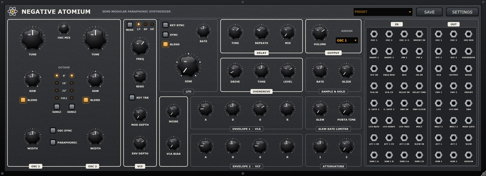

# NegativeAtomium

A semi-modular, paraphonic analog-style synthesizer plugin (AU / VST3 / CLAP, plus a Standalone app for local use), built with JUCE.

**Status:** phase 2 in progress – the DSP core, scalable GUI, and the first functional
patchbay slice are in place.

**Manual:** [English](docs/Manual.md) · [Deutsch](docs/Handbuch.md)



## Signal path

```
OSC 1 ─┐
       ├─ OSC MIX ─┐
OSC 2 ─┘           ├─► VCF ─► OVERDRIVE ─► VCA ─► DELAY ─► OUT
NOISE ─────────────┘    ▲  ▲                ▲  ▲
                 LFO ───┘  └─ ENV 2   ENV 1 ┘  └─ VCA BIAS
```

- 2 oscillators with 5 shapes (sine → triangle → saw → square → tone mod), blended or switched,
  hard sync, paraphonic mode. *Tone mod is an approximation, not yet verified against the hardware.*
- 12 dB multimode filter (LP / BP / HP), key tracking, self-oscillation
- overdrive, bucket-brigade-style delay, 2 × ADSR, LFO, sample & hold, slew/portamento
- the whole engine runs 2× oversampled

## Roadmap

1. ✅ DSP core, fixed signal path, simple GUI
2. ✅ Patching engine and persistent patch state
3. ✅ Patchbay GUI with virtual cables
4. Sound tuning, analog drift, presets

RANGE switches each oscillator between 32' / 16' / 8' (TUNE spans about ±1 octave)
and FULL (TUNE spans about ±10 octaves). MIDI notes are
clamped to C1-C7, matching the reference instrument.

## Patchbay

The patchbay currently exposes 24 sources and 32 destinations. Click a source
socket, then a destination socket to create a cable; click the same destination
again to remove that source. Right-click a destination to clear all of its
cables. Up to four sources can be mixed into one destination, and connections
are stored with the plugin state.

Inputs behave like the hardware jacks: a cable replaces the normalled signal.
Normalled routings (manual chapter 8):

| Input | Normalled from |
|---|---|
| VCF IN | OSC MIX + NOISE |
| FREQ MOD (via MOD DEPTH) | bipolar LFO |
| OD IN → VCA IN → DELAY IN | the previous stage |
| VCA CV | ENV 1 |
| PW 1 / PW 2 | ATT 2 |
| ATT 2 IN | bipolar LFO |
| ATT 1 IN / ATT 1 CV | ATT 2 / ASSIGN |
| S&H IN | NOISE (S&H CLOCK replaces the internal clock) |
| INVERT IN | ENV 2 |
| MULT | bipolar LFO |
| E. GATE 1 / E. GATE 2 | MIDI gate / E. GATE 1 |

Pitch inputs (OSC 1, OSC 2, OSC 1+2) and ASSIGN's OSC CV follow 1 V/oct, with ±1
in the patchbay representing ±5 V. Every cable carries the previous sample's value,
so feedback patches are stable.

**EXT INPUT** is a sidechain bus ("Ext In"): route audio to it from the DAW and it is
summed into the mixer, so it runs through VCF, overdrive, VCA and delay like the
hardware's rear input. Open the VCA with VCA BIAS (or play notes) to hear it.

**LFO SYNC** locks the LFO to the host tempo. The RATE knob then selects one of the
21 clock divisions from the manual (4/1 … 1/64) and, while the song plays, the
phase follows the bar grid (unless KEY SYNC restarts it per note).

**SETTINGS** (header button) holds the options the hardware hides behind button
combinations (manual chapter 5): note priority (last / high / low / high-low for
paraphonic), pitch bend range (0–24 st), key split, pedal mode, envelope retrigger,
autoglide and tune bypass per oscillator, LFO depth / one-shot / retrigger / key rate,
VCF mod source (velocity, mod wheel, aftertouch) with amount, and the ASSIGN output.
Also there: LFO shape order and start phase per knob position, muting notes outside
C1–C7 (instead of clamping them) and the amount of analog pitch drift.
The sustain pedal (CC 64) is always active.

Control ranges follow the specification page of the manual: attack 0.3 ms–5 s
(linear), decay 2.4 ms–10 s, release 1.5 ms–6 s, cutoff 10 Hz–15 kHz, S&H 0.26–28 Hz
with 0.5 ms–1 s glide, slew 1 ms–3 s, portamento up to 10 s, ATT 1 up to +4 dB,
pulse width 1–99 %, delay 25–640 ms. The delay models an 8192-stage BBD whose
bandwidth follows its clock (stages / 2·time).

Envelope retriggering is off by default, as on the hardware: legato notes don't
restart the envelopes. The delay covers 24–640 ms.

## Build

Requirements: CMake ≥ 3.28, a C++20 compiler, Ninja (optional). JUCE and the CLAP extensions are fetched automatically.

```bash
cmake -S . -B build -G Ninja -DCMAKE_BUILD_TYPE=Release
cmake --build build --target NegativeAtomium_VST3 NegativeAtomium_CLAP NegativeAtomium_Standalone
```

Plugins end up in `build/NegativeAtomium_artefacts/Release/`.
Add `-DNA_COPY_PLUGIN=ON` to install them into your user plugin folder after building.

On Linux, install JUCE's dependencies first (see `.github/workflows/build.yml` for the list).

## Tests

```bash
cmake --build build --target NegativeAtomiumTests
./build/NegativeAtomiumTests_artefacts/Release/NegativeAtomiumTests \
    --plugin build/NegativeAtomium_artefacts/Release/VST3/NegativeAtomium.vst3 \
    --demo test-output/demo.wav --screenshot test-output/editor.png
```

Builds run only on demand (pushes don't trigger them, to save GitHub Actions minutes) and publish
release `v<version>` with AU (macOS), VST3, CLAP and Standalone:

- **On a Mac:** `tools/release-mac.sh 0.5.0` builds, tests (incl. `auval`) and packages the macOS
  plugins locally as universal binaries, creates a draft release with them, then lets GitHub build
  only Linux and Windows and publish. `--dry-run` stops after packaging.
- **On a PC:** `gh workflow run build -f version=0.5.0` (or Actions → build → Run workflow) builds
  all three platforms on GitHub.

## Credits

Idea, direction and testing: [sscheppert-blip](https://github.com/sscheppert-blip).
The code, DSP and documentation were written by AI coding agents – OpenAI Codex and
[Claude Code](https://claude.com/claude-code) (Anthropic) – based on those ideas.

## Licensing note

Inspired by a classic semi-modular desktop synth; not affiliated with or endorsed by its manufacturer.
JUCE is used under the AGPLv3 / JUCE licence terms.
